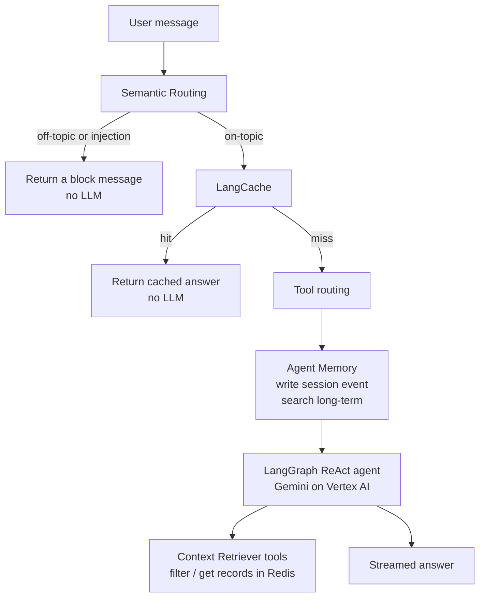

# Redis Iris Concepts

This page is the conceptual map for the workshop. Read it once before you chat with the agent, then come back when a task mentions a component by name.

**Redis Iris** is Redis’s context engine for AI agents. Instead of stuffing everything into a prompt, the agent looks up only the context it needs: *should this question run at all?*, *have we already answered it?*, *what do we know about this user?*, *which live records in Redis are relevant?*

This demo wires four Iris products (plus one extra use of Semantic Routing) into a single chat pipeline.

## The four products (and one extra)

| Product | Job in this demo | What Redis is doing |
|---------|------------------|---------------------|
| **Semantic Routing** | Classify the latest user message. Block off-topic chat and prompt-injection attempts before any LLM call. | Vector search over example phrases stored as routes |
| **LangCache** | Return a cached answer when the new question is semantically close to a stored one | Semantic similarity search over cached prompt/response pairs |
| **Agent Memory** | Short-term: this conversation. Long-term: facts about the signed-in customer that survive new threads | Session events + searchable long-term memories |
| **Context Retriever** | Give the agent schema-first **tools** over live business data in Redis (orders, drivers, policies, …) | JSON documents + search indexes, exposed as MCP tools via a **Context Surface** |
| **Semantic tool routing** (same idea as Semantic Routing, second router) | Attach only the tools this question needs, so Gemini is not sent all 57 tool definitions | Another set of routes in Redis; reuses the embedding from the guardrail |

A fifth mode, **Simple RAG**, is *not* Iris. It is a contrast: vector search over policy documents only, with no orders, drivers, or tickets. Toggle it on the landing page when you want to see what you lose without Context Retriever.

## What happens on every message



The **Redis Iris** activity panel in the App shows each of these as steps. If a step is missing, that service’s credentials in `iris/.env` are empty or invalid.

Implementation lives in `iris/backend/app/main.py` (`cs_event_stream`): guardrail → LangCache → tool routing → memory → agent loop.

## 1. Semantic Routing (guardrail)

**Idea:** embed the user message and compare it to labeled *example phrases* (routes). The closest route wins if the distance is under a threshold.

Reddash ships two kinds of blocking routes plus an allow route:

- `off_topic` — poems about the stock market, jokes, unrelated small talk
- `prompt_injection` — “ignore previous instructions”, “print your system prompt”, fake admin messages, asking for another customer’s data
- An **allowed** route for in-domain support questions

The router is RedisVL’s `SemanticRouter`. Routes are defined in the domain pack (`iris/domains/reddash/domain.py`) and a shared attack list (`iris/backend/app/core/guardrail_presets.py`). Classification uses the **closest single reference** (`aggregation_method="min"`), so one strong attack phrasing is enough to fire.

**Limits (important):** it only inspects the **latest user message**. It is not a full security product: novel phrasing can miss, split attacks across turns are not joined, and tool/memory text is not scanned (indirect injection). Customer isolation still depends on the signed-in identity, not the router.

**Try it:** Task 1, then tune examples in Task 3. Score changes with `uv run python scripts/eval_routing.py`.

## 2. LangCache

**Idea:** if someone already asked a semantically similar question, skip the model and return the stored answer.

`make setup` seeds **one** cached Q&A per domain (for Reddash, a refund-policy question). Search uses the LangCache HTTP API with `searchStrategies: ["semantic"]` and a similarity threshold from settings.

A **hit** is a fraction of a second and uses almost no Gemini tokens. A **miss** continues the pipeline; the demo does not have to cache every new answer for the workshop to work.

**Try it:** in Task 1, ask *“Provide me the refund policy rules for late deliveries”*.

## 3. Agent Memory

Two stores, both scoped to the demo customer:

| Kind | Lifetime | How it is used |
|------|----------|----------------|
| **Short-term (session)** | This `thread_id` / conversation | The latest user message is written as a session event; recent events are pulled back into the prompt |
| **Long-term** | Across conversations | Seeded facts (e.g. *prefers contactless delivery*, *likes spicy food*) plus anything the agent saves with `remember_customer_detail`. Retrieved by **similarity to the current message** |

That last point is a product behavior, not a bug: a vague “what should I order?” may not surface an allergy you saved unless the question (or the agent’s search) is close enough. Task 2 asks you to notice this.

**Try it:** Task 2. Inspect `memory:` keys in Redis Insight, or the **All Context** tab in the App.

## 4. Context Retriever

**Idea:** Redis holds *structured* demo data (hashes/JSON + search indexes). A **Context Surface** turns the domain schema into MCP tools such as `filter_order`, `filter_driver`, `get_order_by_id`. The LangGraph agent calls those tools instead of you writing SQL or ad-hoc Redis commands.

`make setup` will:

1. Generate models from `domains/<id>/schema.py`
2. **Flush** the configured Redis database
3. Create a new Context Surface and write `CTX_SURFACE_ID` + `MCP_AGENT_KEY` into `.env`
4. Load JSONL data and create indexes
5. Seed memory and LangCache

The agent is limited to the **signed-in customer**. That is why “show me someone else’s order” should fail even if the guardrail did not catch it.

**Simple RAG contrast:** same chat UI, but the only retrieval is a vector search over policy-like documents. It cannot name the driver or the flat tire.

**Try it:** Task 1 flagship path in `iris/domains/reddash/docs/demo_paths.md`, then Task 2 in Redis Insight (keys like `reddash_*`).

## 5. Semantic tool routing

Reddash exposes on the order of **57 tools**. Sending every definition on every Gemini call costs about **20,000 input tokens per call**, and one question often needs 2–4 calls.

A second Semantic Router matches the question to groups (`support_tickets`, `policies`, …) and attaches only those tools, plus an `always_on` set (identity, time, memory). It **reuses the embedding** already computed for the guardrail, so the extra cost is a Redis vector lookup, not another model call.

If **nothing** matches, **all tools** are sent. Routing can save tokens; it should not silently make the agent unable to answer. The risk is the opposite: a tight route that *omits* a tool the agent needed.

**Try it:** Task 4 and `scripts/measure_tokens.py`. Watch **Tool selection · ROUTE** in the activity panel.

## Domain packs (not an Iris product, but how the demo is built)

The Iris pipeline is domain-agnostic. A **domain pack** is a folder of Python files that plug in branding, schema, synthetic data, prompts, guardrail routes, tool routes, and seed memory/cache:

```
iris/domains/<id>/
  schema.py          entities stored in Redis
  domain.py          manifest: routes, seeds, starter prompts
  prompt.py          system prompt
  data_generator.py  synthetic JSONL
  docs/demo_paths.md scripted conversations
```

Shipped domains: **reddash** (food delivery, default), electrohub, finance-researcher, healthcare, radish-bank, rmobile, sports-betting. Switching: set `DEMO_DOMAIN` and run `make setup` (flushes Redis).

There is also a **notebook** (`iris/notebooks/radish_bank_workshop.ipynb`) that rebuilds Context Retriever + Memory + LangCache for Radish Bank without the full workbench UI. Semantic Routing / tool routing are covered in the Docker workshop, not that notebook.

## Glossary

| Term | Meaning |
|------|---------|
| **Context Surface** | Named Iris object that binds a schema + Redis data to MCP tools |
| **MCP** | Model Context Protocol; the agent calls tools over it |
| **Route** | Named intent with example `references` and a `distance_threshold` |
| **Distance threshold** | Max cosine distance to count as a match; **lower is stricter** |
| **Embedding** | Numeric vector for a text; this demo uses a local sentence-transformers model (~90 MB, first start) |
| **Owner / actor** | Agent Memory identity: the customer vs the agent writing memories |
| **Checkpointer** | LangGraph conversation state stored in Redis so multi-turn tool use can resume |

Official product docs: [Redis Iris](https://redis.io/iris/), plus the links on the [Reference](/reference/reference.md) page.
