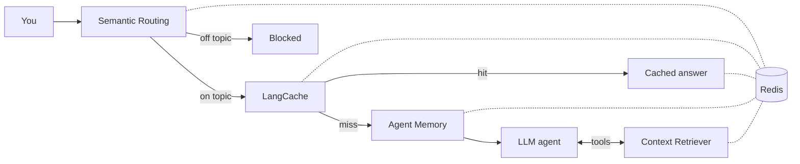

# Welcome to the Redis Iris Workshop

This project is a **browser workbench** around a working AI support agent. The agent is not a toy chatbot over a PDF: it is a **LangGraph** (ReAct) loop on **Gemini (Vertex AI)** that reads and writes **Redis** through **Redis Iris**.

The default story is **Reddash**, a food-delivery help desk. The same pipeline can switch to electronics retail, banking, healthcare, and other **domain packs** without rewriting the Iris stages.

If you are new, start here: **[First-time learner path](learn/first-hour.md)** → then the four tasks. For “what is each product?”, read **[Redis Iris Concepts](concepts/iris.md)**.

## What this repo contains

| Piece | Role |
|-------|------|
| `docs/` | These Docsify pages (you are here) |
| `code/iris/` | FastAPI backend, React chat UI, domain packs, scripts |
| `workbench/` | One-URL UI: docs, VS Code, App, terminal, Redis Insight |
| `docker-compose.yml` | Six containers behind nginx on port 80 |

Iris demo data lives in the **Redis Cloud database** from `iris/.env`, not in the local Redis container. Task 2 shows how to inspect it.

## Redis Iris concepts this workshop covers

| Concept | You will actually do |
|---------|----------------------|
| **Semantic Routing** | Watch off-topic and prompt-injection messages blocked in the activity panel; add your own example phrases |
| **LangCache** | Hit a pre-seeded semantic cache on a refund-policy question |
| **Agent Memory** | Use seeded long-term facts, write a new memory, retrieve it in a new conversation |
| **Context Retriever** | Let the agent call schema-first tools over live Redis records (orders, drivers, tickets, policies) |
| **Semantic tool routing** | Measure Gemini token drop when only a subset of tools is attached |
| **Simple RAG (contrast)** | Same UI, documents only — no operational data |
| **Domain packs** | Edit Reddash or switch `DEMO_DOMAIN` |

Not in the main UI path, but in the repo: a **Radish Bank notebook** that builds Context Retriever + Memory + LangCache by hand.

## How a message flows

Every stage below reads from or writes to Redis (dotted lines):

## Your workbench

| Panel | What it is |
|-------|-----------|
| **Code** | VS Code with the demo in `iris/` |
| **App** | Chat UI and the Redis Iris activity panel |
| **Terminal** | Shell in `/code/iris` for `make` and tests |
| **Redis Insight** | Browse loaded keys (☰ menu; import the DB first — [Task 2](/tasks/task-2.md)) |

## Getting started

1. [Setup Guide](setup/setup.md) — credentials, Gemini, `make setup`
2. [First-time learner path](learn/first-hour.md) — ordered hour of exercises
3. [Task 1](tasks/task-1.md) if you want to jump straight into the scripted chat
